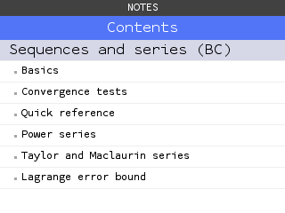
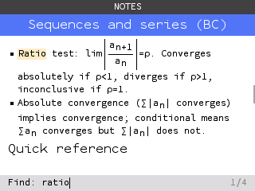
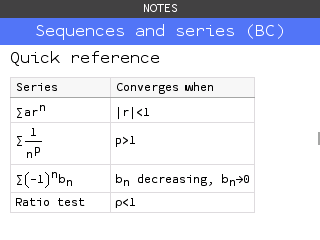

# Notes for NumWorks

An external app for the NumWorks calculator that shows notes written in
Markdown, with LaTeX-style maths drawn the way the calculator draws it:
fractions, roots, exponents, sums, integrals, tables and more.

## Install

1. Plug the calculator in and leave it on "The calculator is connected".
2. Open https://my.numworks.com/apps in Chrome or Edge.
3. Add one of the app files from `notes-app/notes-package/`:
   - `notes.nwa` reads notes from Workshop scripts named `note_<anything>.py`.
   - `notes-data.nwa` also accepts a notes file on the install page
     (several notes in one file, separated by lines starting with `=== Title`).

The full guide, Markdown and maths syntax, and keys are in
[the app README](notes-app/notes-package/README.md).
Source code is in `notes-app/notes-package/source/`.

## Licence

`eadkpp.h` and `external_app.mak` come from NumWorks' external app samples and
are used under their licence, reproduced in [NUMWORKS-LICENSE.txt](NUMWORKS-LICENSE.txt).
NumWorks is a registered trademark of NumWorks SAS; this project is not
affiliated with or endorsed by NumWorks.
